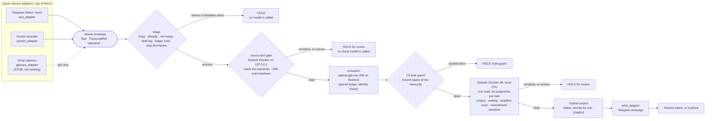

<p align="center">
  
</p>

<p align="center">
  
</p>

# Ratatoskr Demo

**Gatekeeper triage for a voice-to-task courier.**

**Demo video (3 min):** https://youtu.be/dl9dS00GEFY

A conversation ends (on a Pocket wearable
recorder, or typed to a Telegram bot with `/demo`); each follow-up in it lands in Todoist and as a
three-line message on a CircuitMess Artemis smartwatch or any phone with Telegram:

```
research · high · 0.92
Email Priya the preprint
commit yes 0.91 · sens clear 0.82 · prio waiting
```

**Strands Decider 2B**, running on this machine's CPU, is the gate. First it reads the conversation
itself and holds it for review if anything in it is sensitive, or if it is unsure, before any
cloud model sees a word. Only then does an **open-weight model on Amazon Bedrock**
(`openai.gpt-oss-20b`, through the bedrock-mantle Chat Completions endpoint) extract the
commitments, and Decider makes six typed judgments about each task in one read: which project it
belongs to, whether a specific person is waiting on it, whether a stated deadline makes it late after
a date, whether it is worth following up
soon, whether it is a real commitment, and whether it is sensitive. Code turns those into a
priority. The transcript is never persisted, and a code-level tripwire holds any conversation that
names a forbidden client before any model, Decider included, sees it, even when the transcriber
misspells the name or splits it in two ("Vargrime", "var grime"): it matches listed spellings and
the name's sound (Double Metaphone).

Built for the AWS Builder **Agent Experience Hackathon: Strands Decider**. Tags:
`#strands-decider-2b` `#policy`.

> **AI-use disclosure.** Dan Lee-Odinson directed this build and dispositioned its decisions.
> Claude Code (Anthropic's Claude Opus 5.5) wrote the code, the tests and this documentation from
> Dan's written handoff. It is a public spin-off of Dan's private courier, with the personal
> taxonomy and the deployment removed.

## The reusable part: `patterns/gatekeeper_triage/`

Triage before action, as a folder another builder can copy: a code tripwire the model cannot
override; a gate on the source text, where there is one; six typed questions answered by Strands
Decider in one read, with a confidence floor per question and the priority set by a rule in code;
and a hold whenever the answer to "is this sensitive?" is yes or unsure. It ships a
standard-library Decider client (`gate_source_text()` and `triage()`), a Strands Agents
`BeforeToolCallEvent` hook that blocks a pending tool call, the questions as TOML, and a
twenty-line example. See [`patterns/gatekeeper_triage/README.md`](patterns/gatekeeper_triage/README.md).

## What you need

| | what | its role |
|---|---|---|
| **required** | a computer (a laptop is enough) | runs the courier from the command line |
| **required** | an Amazon Bedrock API key | `openai.gpt-oss-20b` extracts the commitments |
| **required** | a Telegram bot and its chat | `/demo <text>` in, `/status`, and every notice out |
| **required** | a Todoist account | where the tasks land, in one project |
| **required** | Strands Decider (local, about 8 GB of RAM) | the source-text gate and the routing (`[route] backend = "decider"`) |
| optional | a Pocket recorder and its API key | conversations in, recorded instead of typed (`inputs = ["pocket", ...]`) |
| optional | an Artemis watch, or any phone with Telegram | where the three-line message is read |
| optional | smart glasses, later, through the mock kit | an input slot only: the glasses adapter is a stub today |
| optional | a TypeSafe API key | the bench's Jev column only |

The minimum install is the five required items, `[devices] inputs = ["text"]` and
`[route] backend = "decider"`. A secret is asked for only when the adapter that uses it
is enabled: no Pocket key without the Pocket input, no TypeSafe key without Jev or the bench.

## System requirements

Decider 2B runs on the host, so the host is the one real requirement. Every number this project
measured, in this README and in the article, was measured on a Windows 11 laptop with 16 logical
cores, Decider held to four of them, and no GPU.

| Host | Minimum | Measured on the reference machine |
|---|---|---|
| CPU | 4 threads free for Decider while it reads; no other CPU-heavy job on the machine | 4 intra-op threads (and 1 inter-op), laptop CPU with 16 logical cores |
| Memory | 16 GB; the server commits about 10 GB, and the memory guard stops it at the `--max-commit-gb` value (off unless given; the start command below sets 16) | 9.9 to 10.4 GB committed over 70 reads per server |
| GPU | None required | None used |
| Disk | Decider weights (4.4 GB in the Hugging Face cache: the 4.3 GB Qwen3.5-2B base model and the 88 MB Decider checkpoint) plus two virtual environments | `.venv-decider` (server), `.venv` (courier) |
| Python | 3.12 or later (`requires-python = ">=3.12"`) | 3.12.10 |
| OS | Windows 11 with PowerShell is what the run commands assume; the courier and the pattern have no Windows-only code (the courier needs `httpx` and `Metaphone` from PyPI; the pattern's client is standard-library Python) | Windows 11 |
| Network | Outbound HTTPS to Bedrock, Telegram, and whichever of Todoist and Pocket are enabled; Decider listens on `127.0.0.1:8000` only and must never be exposed | Same |
| Accounts | AWS with Bedrock model access to `openai.gpt-oss-20b`; Telegram bot token and chat id; Todoist token and Pocket API key only for the adapters you enable | All four |

Measured latency: median 10.8 s per six-question read with the laptop otherwise idle (19 Oct
2026). The overnight pass of 17–18 Oct, also with the laptop otherwise idle, measured 30.2 s;
what changed between them is not established. With another job keeping every core busy, reads
did not finish at all: 0 of 44 answered on 17 Oct.

Recommended settings:

- Start the server with a pid file and the memory guard: `.\.venv-decider\Scripts\python tools\serve_decider.py --pid-file ledger\decider.pid --max-commit-gb 16`
- Keep the courier poll interval at its default of 30 seconds (the config refuses anything lower).
  A read must finish well inside one interval, so do not lower it on a CPU-only host.
- The spend ledger's hard stop is $5.00, and it is a ceiling: `[spend] hard_stop_usd` in the config
  can lower it, and the config refuses anything above `SPEND_CEILING_USD` ($5.00, in
  `ratatoskr_demo/config.py`).
- Write a one-line description for every project in `[project.criteria]` of `prompts/route.toml`
  (the sort reads these; `prompts/context.md` only words the extraction). On the bench, the
  descriptions carried most of Decider's confidence on the project sort (18 of 30 sure with them,
  4 of 30 without).
- Give Decider the machine while it runs. With another job keeping every core busy, reads did not
  finish (above): the courier then makes recordings wait rather than lose them, and the bench can
  hang. The bench timeout is 600 s for that reason; the courier's own read timeout is 180 s.

## How it fits together

Every input and output passes through one small record, the **device envelope**
(`ratatoskr_demo/devices/`): `Envelope(device_id, kind, ts, payload)`, with a payload of
`TranscriptRef`, `Text`, `Button`, `TagRequest`, `AudioRef` or `VideoRef`, validated on
construction and published as JSON Schema. Every input adapter has the same three methods
(`list_new`, `source`, `fetch_text`), and the cycle talks only to adapters: the courier runs the
same with Pocket, with the `/demo` text alone, or with the glasses stub.



**Priority by a rule.** Decider answers three yes/no questions: is a specific person (named, or
known by relationship or role) expecting a reply or a deliverable from the owner, not merely the
owner waiting on someone else (`someone_waiting`); is there a date, time or event set by someone
else, or agreed with them, after which it is late (`hard_deadline`; a date the owner picked for
themself is not one); and is it worth following up in the next few weeks (`worth_researching_soon`).
Code decides, in order: waiting → high; else a deadline within 30 days of the recording → high (a
later one does not count); else worth it → medium; else low. If the step that would decide rests
on an answer Decider is unsure of, the project's default applies. The due date is read by code
(`ratatoskr_demo/due.py`), counted from the recording's own date, never today's. The wrist line says
which step set it: `prio waiting`, `deadline`, `soon`, `none`, or `default:waiting` (and so on: the
unsure question).

## Privacy: content sensitivity checked and protected

**When a privacy check is unsure, the recording is held, never passed through. The only outcome of
an uncertain answer is an id-only notice back to the owner (the recording's id and the kind of hold;
no title, no words from the conversation); the recording is released by a tag (`ok` in Pocket).**

The project sort is not a privacy question: it judges a task whose conversation has already been
cleared, and when it is unsure the task is filed "unsorted", not held.

Privacy is a feature of this design, and these four refusals are how it is built. With Decider
configured, which the quickstart ("Run it") requires, nothing in the config loosens them; the two exceptions
are the `urgent` tag while Decider is unreachable, described below, and the demo-only
`backend = "none"` setting, which runs the courier with no sensitivity gate (the stop-list
tripwire still runs; see "Running without a gate (demo only)").

**The tripwire.** Before any model call, Strands Decider included, a check in code holds any
conversation that names a stop-listed client, even when the transcriber misspells the name or
splits it in two ("Vargrime", "var grime"): it matches listed spellings and the name's sound
(Double Metaphone). The hold notice gives the recording id only, never its title, because Pocket
builds titles from the conversation.

**The source-text gate.** An extraction can drop the very detail that made a conversation
sensitive ("cover Mara's talk", without "she starts medical leave"), so Decider first reads the
transcript itself: split on speaker turns into windows of about 300 words (Decider reads 4,096
tokens), one `sensitive` question per window, and the conversation is held if any window is
sensitive or Decider is unsure of one. Decider is the only model that may read transcript text,
because it is bound to `127.0.0.1` (the config refuses any other host) and persists nothing; a test
fails if transcript text is ever sent anywhere else but the extraction itself. A window takes a
few seconds on four laptop CPU threads (1.7–3.3 s in the 19 Oct bench), which is fine for the
demo's short recordings. With the bench-only `"jev"` backend the source gate is skipped, and the
post-extraction check on each task (below) is the only sensitivity check.

**Task-text sensitivity.** After the extraction, one of Decider's six judgments about each task is
whether a person should review it first: `sensitive` yes, or unsure (below its floor, or an
answer the courier cannot read), holds the whole recording for review, and nothing of it is
written.

**Nothing written while Decider is down.** If Decider is down, a read times out, or Decider
answers in a shape the courier cannot use (an HTTP error, a non-JSON body, no answers), nothing is
written: the recording waits and is retried, and is never sent to Bedrock ungated; after three
cycles without Decider, one notice says how many recordings are waiting. The one exception, for
Decider unreachable and never for an unusable reply: a
recording tagged `urgent` in Pocket is, while Decider is unreachable, extracted and written
unrouted with priority high and the label `unrouted` ("urgent · unrouted" on the wrist); the
tripwire still runs first, and with Decider up `urgent` changes nothing.

Apart from the source gate, the transcript exists only in memory during one cycle: the envelope
carries the recording id, the cycle fetches the text at extraction time, and nothing writes it
anywhere. For routing, Decider is shown only the guarded task, its notes and due date, and the
contact line, never the transcript or the recording's title.

## Safety

Ratatoskr writes to places other people can see. These are the rules that keep a wrong answer from
becoming a visible mistake, and what you are expected to do on your side of them.

**What the courier will never do**

- Store a transcript. The transcript lives in memory for one cycle and is gone when the cycle ends.
  A test checks that no eight-word span from any fixture transcript appears in any output file.
- Post text from a held recording. A hold notice carries the recording id, the kind of hold, and
  the release instruction, and never a word of the recording.
- Pass an unsure privacy answer. A sensitivity answer below its floor holds the recording, at the
  gate and at routing, and a malformed sensitivity answer at routing holds it too. No answer at
  all, or a reply the courier cannot use, makes the recording wait for a healthy server; a wait is
  never read as a yes or a no. The gate runs before extraction, so a recording the gate holds or
  waits on has not left this machine.
- Bypass a Decider verdict. The `urgent` tag skips the gate only while Decider is unreachable; a
  verdict, once given, stands.
- Write anything new while Decider is down. If the health check fails or a read times out, nothing
  is written until a later cycle sees a healthy server; a recording already extracted is not
  written either, and its read is not asked again until then. The one exception is a recording you
  tagged `urgent` yourself, which is written unrouted with the tripwire still run first.
- Spend past the ledger. Bedrock calls stop at the configured cap ($5 by default).
- Talk to a model it did not expect. The model-identity check refuses an endpoint that answers as a
  different model.

**What runs before any model sees a word**

The tripwire is a list of protected names and their known misspellings, matched phonetically and
across adjacent words. A hit holds the recording with no model call. Put every client, patient, or
person you must never post about on that list before the first live run, including the ways a
transcriber is likely to mangle the name.

**Secrets**

Tokens live in `.env`, which is git-ignored. The HTTP log filter redacts tokens from log lines. The
publish step scans tracked files for secrets and for the names on the forbidden-names list, which
lives outside the repo. If a token ever appears in a log, a screenshot, or a commit, rotate it at
the provider before doing anything else.

**Decider stays local**

The server listens on `127.0.0.1:8000`. Do not bind it to another interface, put it behind a reverse
proxy, or run it on a machine other people can reach. The whole privacy design rests on the
sensitivity judgment being made on the machine that holds the transcript.

**What you must do**

- Tell people you are recording. Laws on recording conversations differ by place, and some require
  every party's consent. The courier does nothing to establish consent; that is yours.
- Read the held items. A hold is a question for you, with a one-line notice and no text. Release
  with a tag or leave it; the courier will not decide for you.
- Keep the project criteria current. The project sort's confidence comes mostly from the one-line
  criteria under `[project.criteria]` in `prompts/route.toml`; a stale list means more tasks arrive
  unsorted.
- Give Decider the machine while it runs. Starved of CPU, reads overrun their timeout, the health
  check makes recordings wait, and a bench can hang (see System requirements).

**Where the judgments are weak**

The bench is thirty labeled fixture tasks and five tasks from live recordings. On those, Decider's
project sort misfiled nothing: it was sure on 18 of the 30 fixtures, right on all 18, and left the
other 12 unsorted; on the five live tasks it was sure of none and left all five unsorted. The
hard-deadline question was wrong on 12 of the 21 answers it was sure about against the labels as first
written (5 of 21 against the labels as corrected on 20 Oct, Dan's ruling 40). The priority rule takes
a sure "deadline: yes" at face value and reads the date in code only to decide whether it falls
within thirty days, so a wrong yes costs a priority level and never a task. Priority and project are
filing decisions and fail safe (the task lands on the list unsorted, and the wrist says so).
Sensitivity decisions fail closed (hold). Use the courier for lists where a misfiled task costs you
a minute, and keep it away from anything where a misfiled task could cost someone else more than
that.

## What it does not do

- It runs from the command line on one machine. There is no web interface, no database and no
  queue; Strands Decider is served on `127.0.0.1` and nothing else may reach it.
- The glasses adapter is a stub: it accepts an envelope carrying a `VideoRef` and returns it
  unchanged, so the seam has the slot. Nothing reads video.
- It never deletes a recording, and it sends messages only to the one Telegram chat configured.
- Tasks go to one Todoist project (`Ratatoskr Demo`) and nowhere else.
- Strands Decider on a laptop CPU is not fast (see "How fast Decider is here" below): a recording
  with three commitments takes about half a minute to a minute to route. It costs nothing per call and never
  leaves the machine. The demo is filmed with one-commitment recordings and `/demo`.
- Extraction quality is that of a 20-billion-parameter open-weight model at low reasoning effort:
  it misses some commitments and due dates. The leak guard, not the prompt, is what keeps the
  transcript's wording out of the output.

## How fast Decider is here

| | where | what one read covers | time |
|---|---|---|---|
| **this build** (measured 19 Oct 2026) | a laptop CPU, **4 threads**, full precision (fp32), below-normal priority, strands-decider 0.1.0, v21 | all the questions about one task in one read, about 960–980 tokens | **about 11 s** per task (bench median 10.8 s; 10.5–18.1 s in the live run) |
| Strands Decider's README | an NVIDIA RTX 3090 under WSL2, v19 | one JevBench question | median **115 ms** (95th percentile 299 ms) |

The second row is the project's own GPU figure, for an earlier checkpoint and one question at a
time; **the first row is the one that applies to this build.** Up to the overnight bench of
17–18 Oct the same reads took 20–40 s (median 22–30 s); from the first live run on 18 Oct they
took 10–18 s. What changed is not established. The demo machine shares its CPU
with another long-running job, so Decider is held to four threads throughout. Decider's prefix
cache stays on: without it a read took 46–94 s.

## Safeguards (all fail closed)

| Safeguard | Where |
|---|---|
| No transcript persistence (C1); the `/demo` text is a transcript too | `cycle.py`, tests in `test_leak.py`, `test_devices.py` |
| Stop-list tripwire before any model call, Decider included; it matches listed spellings and sound-alikes ("Vargrime", "var grime") | `triage.py`, tests in `test_triage.py` |
| Source-text gate before any Bedrock call; transcript text only ever to Decider on loopback, or to the extraction | `source_gate.py`, `test_source_gate.py` |
| Leak guard: any 8-word transcript span in model output is rejected, retried once, then held | `guard.py` |
| Hold on sensitive or unsure | `cycle.py`, `judge.py` |
| Notices carry the recording id only, never its Pocket title (Pocket builds titles from the conversation) | `cycle.py`, `commands.py`, tests in `test_notices_and_short.py`, `test_leak.py` |
| A transcript under 8 words (an accidental press) is skipped before any model: no read, no notice | `cycle.py`, `test_notices_and_short.py` |
| Bedrock spend ledger: worst case reserved before every call, **hard stop at $5.00** | `spend.py` |
| Model identity: every response must name `openai.gpt-oss-20b` | `bedrock.py` |
| Model record: the model's `GET /v1/models` entry must match `config/model_baseline.json` | `bedrock.py` |
| Lost network vs Bedrock error: a lost network is never counted; a request that went out stays at worst case | `bedrock.py` |
| The key only in the Authorization header; no secret in any log, ledger or exception | `bedrock.py`, `test_leak.py` |
| Idempotent writes: deterministic Todoist command ids | `todoist.py` |

The nine hard constraints are in [`CLAUDE.md`](CLAUDE.md).

## Run it

Python 3.12. Two virtual environments: one for the courier, one for Strands Decider (torch lives
there).

```bash
python -m venv .venv
.venv/Scripts/python -m pip install -e ".[dev]"
python -m venv .venv-decider
.venv-decider/Scripts/python -m pip install strands-decider==0.1.0
```

Copy `.env.example` to `.env` and fill in the keys the enabled adapters need (see "What you need":
at least the Bedrock key, the Telegram bot token and chat id, and the Todoist token). Then:

```bash
.venv-decider/Scripts/python tools/serve_decider.py
```

starts Strands Decider on `127.0.0.1:8000`, on the CPU, capped at four threads (the first run
downloads the Qwen3.5-2B base model, about 4.5 GB). Leave `[route] backend = "decider"` in
`config.toml`, as shipped. In another terminal:

```bash
.venv/Scripts/ratatoskr-demo --decider-check
.venv/Scripts/ratatoskr-demo --once --dry-run
.venv/Scripts/ratatoskr-demo --loop
```

`--loop` polls Pocket every 30 seconds and answers `/status` and `/demo <text>` on Telegram, from
the configured chat only. Other commands: `--spend` (the Bedrock ledger), `--rotate-options N` (the
option-order test), `--inspect-shape <recording_id>` (key names and types of one real recording,
never values), `--scrub-list`. For the bench's real-task set, `--once --dry-run --save-tasks`
(optionally with `--demo-text "<text>"` and `--option-descriptions on|off`) saves the guarded
extractions, never the transcripts, to the git-ignored `bench/raw/`.

### Running without a gate (demo only)

With `[route] backend = "none"` and no Decider, no sensitivity check runs and nothing is held for
sensitivity (the stop-list tripwire still runs); the courier logs
`backend=none: no sensitivity gate; nothing is held for sensitivity (the stop-list tripwire still runs)`
at startup, and every task it writes carries the label `ungated`, which the wrist shows in place of
the sensitivity field.

## Set up your projects and your stop list

After the install above. Everything here is a file you edit; nothing needs code.

1. **Where the project list lives.** Two files, packaged in `ratatoskr_demo/prompts/`. Copy both
   to a `prompts/` folder at the repository root and edit the copies there: a copy in that folder
   (`[paths] prompts_dir` in `config.toml`) wins over the packaged one.
   - `route.toml`, section `[project]`, is the sort. Each project is one line in
     `[project.criteria]`, a short name and a one-line description in your own words, and one
     line in `[project.defaults]`, the priority (`"low"`, `"medium"` or `"high"`) that project's
     tasks get when the priority step that decides is unsure. The name is one word: it becomes
     the Todoist label `proj:<name>`. Every project needs a default, and a startup error names any
     that is missing. Keep `other`: the question tells Decider to choose it when nothing fits.
   - `context.md` gives the extraction the same areas in plain sentences, one `- Name:
     description` line each, so tasks come out worded sensibly.

   One entry as it is today, in `route.toml`:

   ```toml
   [project.criteria]
   research = "Papers, preprints, reviewers, data and methods."

   [project.defaults]
   research = "medium"
   ```

   and in `context.md`:

   ```
   - Research: papers, preprints, reviewers, data and methods.
   ```

2. **Write descriptions the sort can use.** Decider judges each task (its text, its notes, and the
   contact's organisation and role) against these lines. Make each one concrete and one line long,
   naming the kinds of task and the people that belong there. Four to six projects that do not
   overlap sort better than seven that do.
   - Good (today's `school`): `"Coursework, assignments, instructors, registration, study
     partners."` It names things and people, and no other project claims them.
   - Weak: `"Stuff for my studies and other important things."` It names no kind of task, and
     "important things" overlaps every other project.

   What the 19 Oct measurement showed: the descriptions carry most of the sort's confidence. With
   the project names alone, Decider was sure of a project for 4 of 30 test tasks instead of 18. On
   real conversations the sort often stays unsure: of the five tasks from the first live run it
   was sure of none, with or without the descriptions, and the courier files each one unsorted.

3. **The stop list.** In `config.toml`, `[triage] stop_list` holds one entry per protected name,
   the name as `term` and every misspelling a transcriber has produced as `spellings`:

   ```toml
   stop_list = [{ term = "vargrheim", spellings = ["vargrime"] }]
   ```

   Add a name as another `{ term = "...", spellings = ["...", "..."] }` in the list (`spellings`
   may be left out); the list may not be empty. A recording is held if the term or a listed
   spelling appears in its title or transcript, in any case, or if a word there, or two
   neighbouring words written together, sounds like the term (Double Metaphone). This is code
   (`ratatoskr_demo/triage.py`) that runs before any model sees the conversation, Strands Decider
   included; no model takes part in it, and none can override it. The hold notice gives the
   recording's id only; tag the recording `ok` in Pocket to release it.

4. **Where tasks land, and "unsorted".** In `config.toml`, `[todoist] inbox_project_name =
   "Ratatoskr Demo"` is the one Todoist project every task goes to (created if it is missing), and
   `label = "pocket"` goes on every task. A sorted task also gets `proj:<project>` (for example
   `proj:research`); a task written under the `urgent` tag while Decider was unreachable gets
   `unrouted`. The wrist's first line is `<project> · <priority> · <confidence>`. **"unsorted"**
   in the project's place means Decider's project answer was below its floor (`min_confidence =
   0.70` under `[project]`): the task is still written, to the same Todoist project, with the
   `pocket` label and no `proj:` label, and the confidence shown is that unsure answer's. If its
   priority also rested on an unsure answer, it has none, since there is no project default to
   fall back on.

5. **Check the setup before the first run.** With Strands Decider serving (under "Run it"):

   ```bash
   .venv/Scripts/ratatoskr-demo --decider-check
   ```

   It asks Decider about one invented test task and prints the answers beside the expected ones.
   A good result looks like this (the numbers vary):

   ```
   decider-check: 1 canonical fixture task (rec_001) -> strands-decider-2B-hobson-v21 (<n> input / <n> output tokens, <n> ms)
   task:    <the test task>
   decider: project research <c> · priority high by waiting · waiting p=<p> <c> · deadline p=<p> <c> · soon p=<p> <c> · commit p=<p> <c> · sensitive p=<p> <c>
   expected: project research, priority high, commitment True, sensitive False
   ```

   Each yes/no question shows Decider's probability of yes (`p=`) and its confidence; an answer
   under its floor is marked `(below floor)`. `decider-check: Strands Decider not usable at
   http://127.0.0.1:8000: ...` means Decider is not running or answered in a shape the courier
   refuses. Then:

   ```bash
   .venv/Scripts/ratatoskr-demo --once --dry-run
   ```

   It runs one poll against your real inputs and writes nothing: no task, no notice, no ledger
   entry. The log lines of a good run look like these, from the 19 Oct dry run (titles replaced):

   ```
   INFO ratatoskr_demo.bedrock: bedrock: model record for openai.gpt-oss-20b matches the baseline
   INFO ratatoskr_demo.decider: route: Strands Decider up (StrandsAgents/strands-decider-2B-hobson-v21, device cpu)
   INFO ratatoskr_demo.cycle: network up
   INFO ratatoskr_demo.source_gate: source gate: 1 of 1 window(s) asked, max p=0.22 -> clear
   INFO ratatoskr_demo.decider: route: project=None priority=None (default:waiting) real_commitment=True sensitivity=clear
   <recording id>  '<title>': Process
       would create: <task>  labels=['pocket']  priority=-
   ok: 7 listed, 7 examined; today 0 processed, 0 held, 0 errors
   ```

   Good means: the model record matches, Decider is up, an ordinary conversation clears the gate,
   every recording has a triage line (`Process`, or `Hold` / `StillHeld` where you expect a hold),
   and the last line starts with `ok:`. A stop-listed recording shows `Hold (stoplist:<term>)` with
   no model line for it. `project=None`, and `labels=['pocket']` with no `proj:` label, mean the
   sort was unsure: that task would be filed unsorted.

## Measured

`bench/run_bench.py` asks the same six questions of Strands Decider on the CPU, of
`openai.gpt-oss-20b` on Bedrock (as a JSON-answer prompt with the same question text) and of
TypeSafe's Jev, over every task extracted from the fixtures and over the 30 canonical tasks as
written, and scores each against the fixtures' expected answers; it also runs the source-text
gate on every transcript first. The generated report is [`bench/RESULTS.md`](bench/RESULTS.md).
With `--option-descriptions both` it asks every task twice, with each project option's one-line
description and with the names alone, side by side; `--real-tasks` adds tasks saved from real
recordings (reported as counts, never their text).

On the 30 canonical tasks (19 Oct 2026, the laptop otherwise idle), with each project option's
one-line description, as the courier asks, against the labels as first written on 18 Oct (RESULTS.md
also counts them as corrected on 20 Oct; only the priority row moves, to 50% / 70% / 63%):

| | Strands Decider (laptop CPU, 4 threads) | gpt-oss-20b on Bedrock | Jev |
|---|---|---|---|
| hold decision (sensitive or unsure) right | 30/30 | 27/29 | 29/30 |
| project right / sure / right when sure | 80% / 60% / **100%** | 80% / 93% / 86% | 90% / 87% / 96% |
| priority right (set by the rule) | 53% | 73% | 67% |
| real commitment right when sure | **100%** | 97% | **100%** |
| sensitive right when sure | **100%** | 96% | **100%** |
| median latency per task | 10.8 s | 1.7 s | 0.15 s |
| cost per task | $0 | about $0.00013 | about $0.00005 |

**The option descriptions.** Asked again with the project options as their names alone, Decider
was sure of the project for 4 of 30 tasks instead of 18 (right 22 of 30 instead of 24), and on
the 16 extracted tasks for 2 instead of 10 (right 10 instead of 16). Bedrock and Jev lost
agreement too (each 22 of 30, from 24 and 27). The one-line descriptions carry most of what makes
Decider sure of a project.

**The real tasks.** The first live run's five tasks, extracted again from Dan's own recordings,
are two commitments in different words, so this is a very small sample. Decider was not sure of
the project for any of them, with or without the descriptions (with them it leaned mostly to
`other`, never above p 0.30): in the courier all five go to "unsorted", as the courier's own dry
runs showed. With the descriptions, Jev put all five in `research` (4 sure) and Bedrock four (the
fifth in `community`), all sure; without them, the three backends moved most of them to `work` or
`writing`.

What the numbers say: for the project, the commitment and the sensitivity, Decider's confidence is
what makes the floors useful: when it was sure of them it was right every time, and when it was
not, the task went to "unsorted" instead of the wrong project. That does not hold for every
question (RESULTS.md counts the sure-and-wrong answers per question), and on the real tasks it was
never sure of the project at all. gpt-oss-20b called itself sure of nearly every answer, including
the wrong ones. The source-text gate held both confidential conversations before any Bedrock
call, and cleared the other ten. The deadline question is the exception: Decider reads "a stated
date after which it is late" more strictly than the labels and was confidently "no" on 12 tasks
labelled yes, so its floor does not protect that question, and it was confidently "yes" on 4
`someone_waiting` tasks labelled no (two where the owner is the one waiting); its priority agrees
16 of 30 against 22 and 20. Those counts are against the labels as first written; Dan's ruling 40
corrected twelve labels on 20 Oct, after which the deadline question is wrong on 5 of its 21 sure
answers, waiting on 3 of 15, and priority agrees 15, 21 and 19 of 30. Decider is the slowest of the three on a laptop CPU; it is also the
only one that costs nothing and never leaves the machine. Rotating the order of the project
options seven ways changed the answer for 2 of 30 tasks, each between `work` and `other`: the
same two with the same counts as on 18 Oct (3 of 30 on 17 Oct, with an older wording). The
first-listed option was picked no more often than chance (13.8% against 14.3%). The fixtures and
the expected answers are invented, so these are small-sample numbers.

## Tests

`pytest` runs without a network or a `.env`: Bedrock, Strands Decider, Pocket, Todoist, Telegram
and TypeSafe are all mocked, and a guard makes any real connection fail. `python
tools/check_tests_bite.py` breaks each safeguard on purpose and checks that its tests go red.

## Contributing

Contributions are welcome. Read [CONTRIBUTING.md](CONTRIBUTING.md) for how to set up, test, and send a change, and [CODE_OF_CONDUCT.md](CODE_OF_CONDUCT.md) for how we treat each other here.

## Terms of use

Ratatoskr is a personal project published under the Apache License 2.0. The license is the
agreement; this section says in plain words what that means for someone who runs it.

- **As is.** The software is provided without warranty of any kind, as the license states. It is
  a demonstration of a pattern, directed and measured by one person on one laptop. Nothing in the
  README, the article, or the bench results is a promise about how it will behave on your
  machine, with your recordings, or with your accounts.
- **Your accounts, your spend.** You run it with your own AWS, Telegram, Todoist, and Pocket
  credentials, under those providers' terms. The spend ledger is a guard the courier enforces on
  its own calls; it does not cap what your AWS account can be billed for by anything else, and
  you are responsible for the bill.
- **Your recordings, your consent.** You are responsible for having the right to record and
  process every conversation you feed it, under the laws where the recording happens and under
  the terms of the recording device.
- **The privacy checks are filters, not guarantees.** The tripwire matches a list you maintain.
  The sensitivity gate is a model judgment with a floor. The tripwire holds on a match; the gate
  holds when unsure; either can still be wrong. Review what they hold, and do not route anything
  through the courier that would cause harm if a single line reached a shared list.
- **What it talks to.** The courier sends traffic only to the services you configure. The
  Decider server contacts the Hugging Face Hub to download its 4.4 GB of weights on first start
  and to check for updates on later starts; set `HF_HUB_OFFLINE=1` after the first start if you
  want no contact at all. Nothing is sent to the project's author.
- **Fixtures are fictional.** Every name, company, and conversation in `tests/fixtures/` and
  `bench/fixtures/` is invented. Any resemblance to a real person or organization is coincidental.
- **Contributions.** By submitting a pull request you agree that your contribution is licensed
  under Apache-2.0, as section 5 of the license provides.
- **Trademarks.** Pocket, Todoist, Telegram, CircuitMess, Amazon Bedrock, and Strands are their
  owners' marks. This project is not affiliated with or endorsed by any of them.
- **AI-use disclosure.** The code was written by Claude Code under the author's direction; the
  author dispositioned every design question. The animation, presenter restyling, and music in
  the demo video were generated under the author's direction.

This section is a plain-language summary and is not legal advice; the license text governs.

## License

Copyright 2026 Dan Lee-Odinson. Licensed under the Apache License 2.0; see LICENSE and NOTICE.
